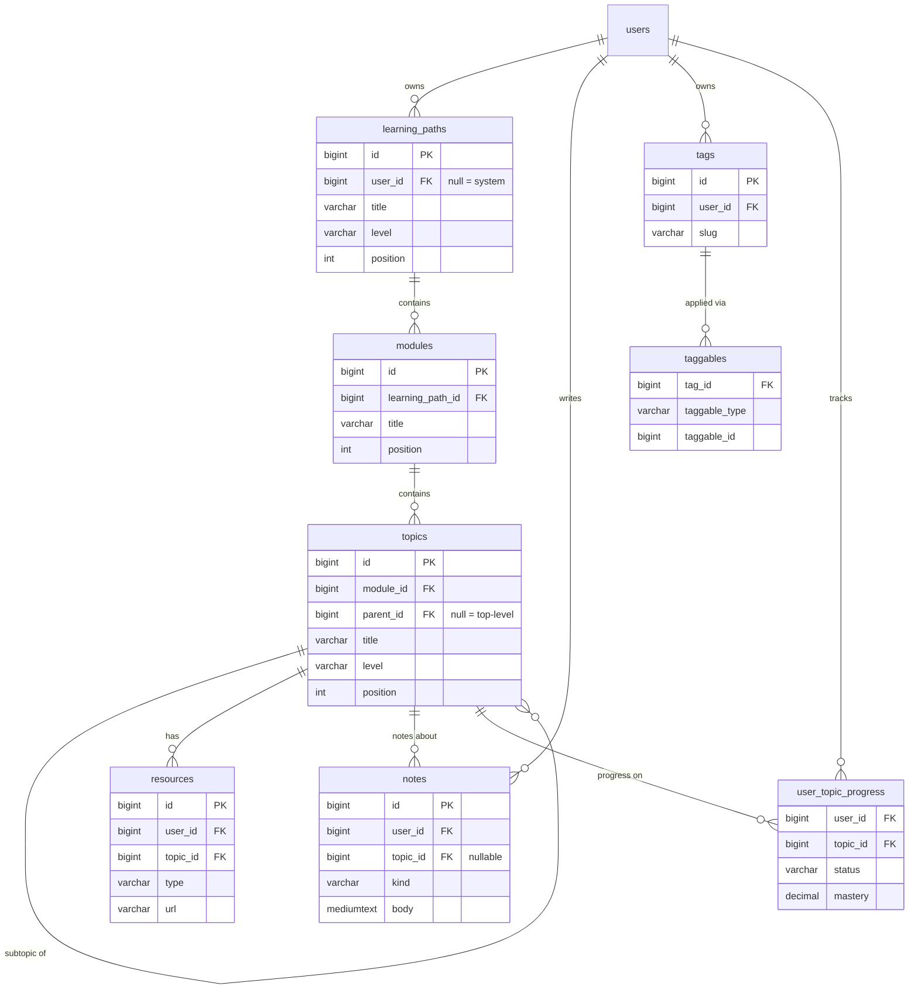
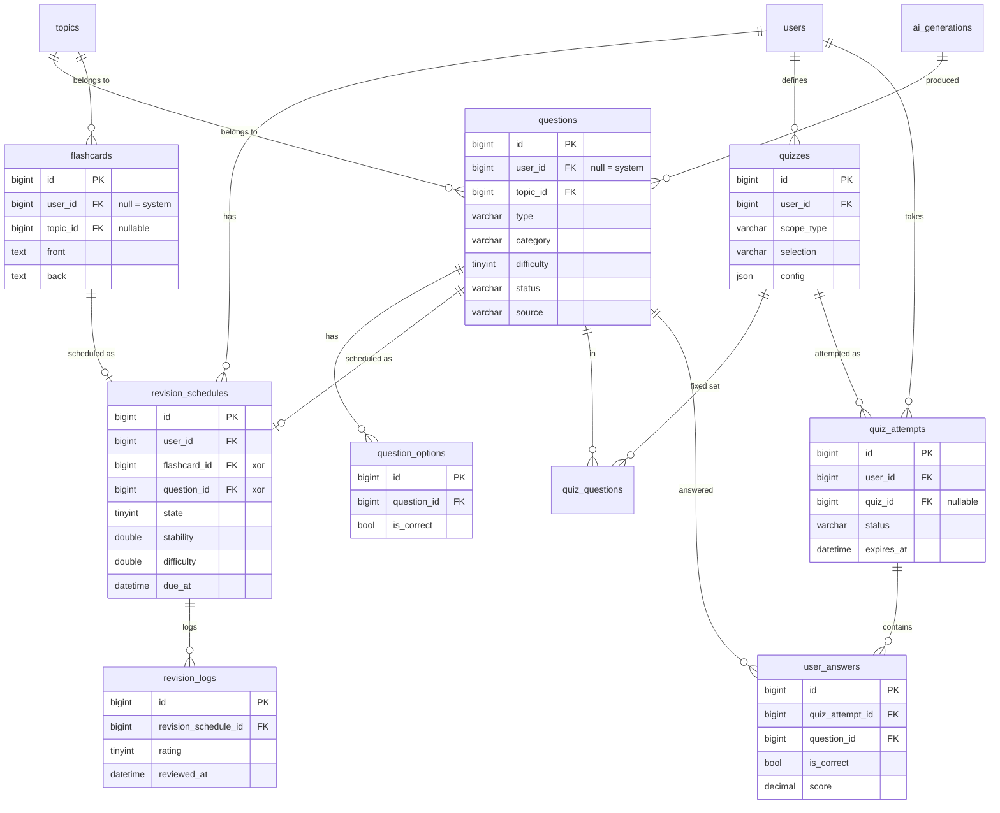
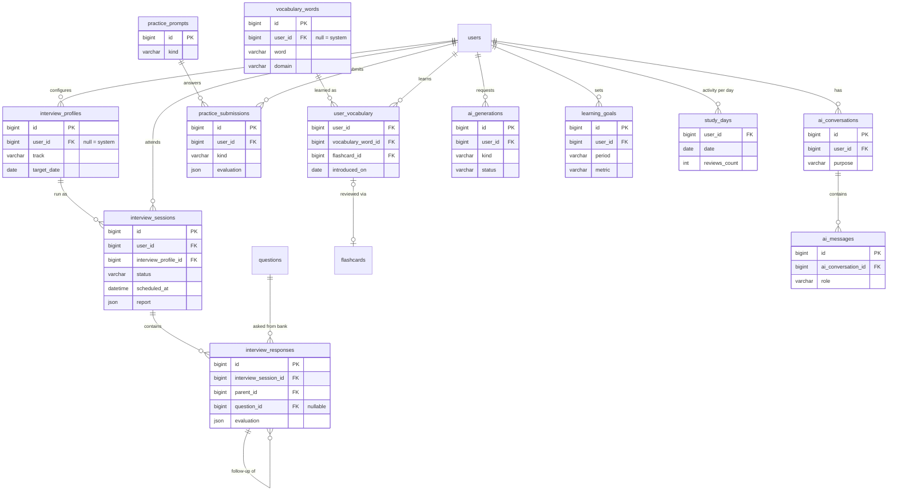

# LearnOS – ER Diagram & Table Definitions

Target: **MySQL 8.0** (InnoDB, utf8mb4_unicode_ci). Laravel default tables (`password_reset_tokens`, `sessions`, `cache`, `jobs`, `job_batches`, `failed_jobs`) are not repeated here.

## Conventions
- PK `id BIGINT UNSIGNED AUTO_INCREMENT`. Ownership is enforced by policies, so sequential IDs are acceptable.
- **Content vs progress.** Content tables (`learning_paths`, `modules`, `topics`, `flashcards`, `questions`, `question_options`, `vocabulary_words`, `practice_prompts`, `interview_profiles`) never hold per-user performance. Per-user state lives in `revision_*`, `quiz_attempts`, `user_answers`, `user_topic_progress`, `user_vocabulary`, `study_days`, `interview_*`, `practice_submissions`.
- **System content:** content tables with a nullable `user_id` treat `NULL` as seeded, read-only content visible to everyone. Users can read it and practise it (progress is theirs), but can't edit it.
- **Soft deletes** on user-authored content (marked SD). History tables are append-only or cascade with their parent.
- **Deleting a user** cascades through every user-owned row.
- Enums are stored as `VARCHAR(32)` backed by PHP enums, not MySQL `ENUM`, so new values don't need `ALTER TABLE`.
- "Index" lists are derived from the queries in [api/endpoints.md](api/endpoints.md).

---

## 1. Learning structure & knowledge

## 2. Questions, revision & quizzes

## 3. Interview, English, AI, goals

---

## Table definitions

Legend: **FK→x (C)** = cascade on delete, **(N)** = set null, **(R)** = restrict. SD = soft deletes. All tables have `created_at` and `updated_at` unless noted.

### users
| Column | Type | Notes |
|---|---|---|
| name, email, password, remember_token, email_verified_at | Laravel default | `email` UNIQUE |
| timezone | VARCHAR(64) | default `UTC`; defines the "day" for streaks and goals |
| desired_retention | DECIMAL(3,2) | default 0.90, range 0.70–0.97 |
| daily_new_limit | SMALLINT UNSIGNED | default 20 |
| daily_review_limit | SMALLINT UNSIGNED | default 200 |
| ai_use_notes_context | BOOL | default true; privacy toggle |
| settings | JSON NULL | UI preferences only (never queried) |

### learning_paths (SD)
| Column | Type | Notes |
|---|---|---|
| user_id | FK→users (C) NULL | NULL = system |
| title | VARCHAR(150) | |
| description | TEXT NULL | |
| level | VARCHAR(32) | beginner / intermediate / advanced |
| color, icon | VARCHAR(32) NULL | UI |
| position | INT UNSIGNED | |
Indexes: `(user_id, position)`.

### modules (SD)
`learning_path_id` FK (C), `title` VARCHAR(150), `description` TEXT NULL, `level` VARCHAR(32) NULL, `position` INT.
Indexes: `(learning_path_id, position)`.

### topics (SD)
`module_id` FK (C), `parent_id` FK→topics (C) NULL, `title` VARCHAR(150), `summary` TEXT NULL, `level` VARCHAR(32), `estimated_minutes` SMALLINT NULL, `position` INT.
Indexes: `(module_id, parent_id, position)`. **Depth is limited to 2** (topic → subtopic) in validation, which keeps tree queries to one query per path.

### resources (SD)
`user_id` FK (C), `topic_id` FK (C), `type` VARCHAR(32) (link, article, video, book, course, doc), `title` VARCHAR(200), `url` VARCHAR(2048), `description` TEXT NULL, `position` INT.
Indexes: `(topic_id, user_id, position)` (every read is per topic *and* user, since resources are private on shared system topics), `(user_id)`.
Model class: `LearningResource` (`Resource` clashes with the PHP pseudo-type in docblocks).

### tags / taggables
`tags`: `user_id` FK (C), `name` VARCHAR(50), `slug` VARCHAR(60), with **UNIQUE `(user_id, slug)`**.
`taggables`: `tag_id` FK (C), `taggable_type` VARCHAR(64), `taggable_id` BIGINT. PK `(tag_id, taggable_type, taggable_id)`; index `(taggable_type, taggable_id)`. No timestamps. These polymorphic rows have no FK on the target, so they're cleaned up in model `forceDeleted` events.

### notes (SD)
| Column | Type | Notes |
|---|---|---|
| user_id | FK (C) | |
| topic_id | FK→topics (N) NULL | Notes may be unfiled |
| title | VARCHAR(200) | |
| kind | VARCHAR(32) | general, explanation, example, snippet, mistake, feynman, summary |
| body | MEDIUMTEXT | Markdown source of truth |
| is_pinned | BOOL | |
| source | VARCHAR(16) | manual / ai |
Indexes: `(user_id, topic_id)`, `(user_id, updated_at)`, **FULLTEXT `(title, body)`**.

### questions (SD)
| Column | Type | Notes |
|---|---|---|
| user_id | FK (C) NULL | NULL = system bank |
| topic_id | FK→topics (C) | Subject and module are derived through topic, not duplicated |
| type | VARCHAR(32) | Answer format: `single_choice`, `multi_choice`, `true_false`, `short_answer`, `long_answer`, `coding` |
| category | VARCHAR(32) | Purpose: `concept`, `practical`, `scenario`, `debugging`, `architecture`, `interview`, `problem_solving`, `communication` |
| difficulty | TINYINT UNSIGNED | 1–5 |
| stem | TEXT | Markdown |
| expected_answer | MEDIUMTEXT NULL | Model answer / rubric |
| explanation | TEXT NULL | |
| references | JSON NULL | `[{title,url}]`, read only as a unit |
| code_language | VARCHAR(32) NULL | coding |
| starter_code | TEXT NULL | coding |
| status | VARCHAR(16) | draft, pending_review, approved, rejected, archived |
| source | VARCHAR(16) | manual, ai, seed |
| ai_generation_id | FK→ai_generations (N) NULL | |
Indexes: `(topic_id, status, difficulty)`, `(user_id, status, created_at)`, **FULLTEXT `(stem)`**.

> The spec lists "scenario / debugging / architecture / interview" as question *types*. They're modelled as `category` because they're independent of answer *format*: a debugging question can be MCQ or long-answer.

### question_options
`question_id` FK (C), `body` TEXT, `is_correct` BOOL, `explanation` TEXT NULL, `position` TINYINT. Index `(question_id, position)`. No SD (replaced together with their question).

### flashcards (SD)
`user_id` FK (C) NULL, `topic_id` FK (N) NULL, `note_id` FK→notes (N) NULL (card made from a note), `front` TEXT, `back` TEXT, `hint` VARCHAR(255) NULL, `source` VARCHAR(16).
Indexes: `(user_id, topic_id)`.

### revision_schedules (per user, per reviewable item)
| Column | Type | Notes |
|---|---|---|
| user_id | FK (C) | |
| flashcard_id | FK→flashcards NULL | exactly one of flashcard_id / question_id |
| question_id | FK→questions NULL | |
| topic_id | FK→topics (N) NULL | **Denormalized** copy of the item's topic so weak-topic aggregation avoids a two-way join |
| state | TINYINT | 0 new, 1 learning, 2 review, 3 relearning |
| stability | DOUBLE NULL | FSRS S (days) |
| difficulty | DOUBLE NULL | FSRS D (1–10) |
| due_at | DATETIME | UTC |
| last_reviewed_at | DATETIME NULL | |
| reps, lapses | INT UNSIGNED | |
| is_suspended | BOOL | |
Constraints: **UNIQUE `(user_id, flashcard_id)`**, **UNIQUE `(user_id, question_id)`** (MySQL allows multiple NULLs, so both work), CHECK `(flashcard_id IS NULL) <> (question_id IS NULL)`.
Indexes: `(user_id, is_suspended, due_at)` for the review queue, `(user_id, topic_id)` for weak topics.
> MySQL rejects CHECK constraints on columns that have FK *actions* (CASCADE/SET NULL). So the item FKs use RESTRICT, and `ReviewService` removes schedules before an item is force-deleted. Soft deletes are the normal path. Verify this when writing the phase-4 migration.

Why not a polymorphic `reviewable_type/id`? Two typed FKs keep referential integrity and use plain indexes; there are only two reviewable types (vocabulary is reviewed as flashcards).

### revision_logs (append-only, `reviewed_at` only, no updated_at)
`user_id` FK (C), `revision_schedule_id` FK (C), `rating` TINYINT (1 Again, 2 Hard, 3 Good, 4 Easy = the confidence rating), `source` VARCHAR(16) (review, quiz), `state_before` TINYINT, `stability_before`/`stability_after` DOUBLE, `difficulty_before`/`difficulty_after` DOUBLE, `retrievability` DOUBLE NULL (R at review time), `elapsed_days` DOUBLE, `scheduled_days` DOUBLE, `duration_ms` INT UNSIGNED, `reviewed_at` DATETIME.
Indexes: `(user_id, reviewed_at)`, `(revision_schedule_id, reviewed_at)`.

### quizzes (SD)
`user_id` FK (C), `title` VARCHAR(150), `scope_type` VARCHAR(32) (topic, module, learning_path, mixed), `scope_id` BIGINT NULL (path, module or topic id, validated by the service), `selection` VARCHAR(16) (random, fixed), `mode` VARCHAR(16) (practice, assessment), `question_count` SMALLINT, `time_limit_seconds` INT NULL, `config` JSON (difficulty range, types, categories, topic_ids for mixed, interleave flag).
Indexes: `(user_id, created_at)`.

### quiz_questions (fixed quizzes)
`quiz_id` FK (C), `question_id` FK (C), `position` SMALLINT. PK `(quiz_id, question_id)`.

### quiz_attempts
`user_id` FK (C), `quiz_id` FK (N) NULL (ad-hoc quizzes have none), `mode` VARCHAR(16), `status` VARCHAR(16) (in_progress, submitted, grading, graded, expired), `started_at`, `expires_at` NULL (**the server enforces the time limit**), `submitted_at` NULL, `question_count` SMALLINT, `correct_count` SMALLINT NULL, `score` DECIMAL(7,2) NULL, `max_score` DECIMAL(7,2) NULL.
Indexes: `(user_id, status)`, `(user_id, submitted_at)`, `(quiz_id)`.

### user_answers
`quiz_attempt_id` FK (C), `question_id` FK (R), `position` SMALLINT, `selected_option_ids` JSON NULL, `answer_text` MEDIUMTEXT NULL, `is_correct` BOOL NULL, `score` DECIMAL(5,4) NULL (0–1), `feedback` TEXT NULL, `graded_by` VARCHAR(16) NULL (auto, ai, self), `confidence` TINYINT NULL, `time_spent_ms` INT NULL, `answered_at` DATETIME NULL.
Constraints: **UNIQUE `(quiz_attempt_id, question_id)`**; index `(question_id)`.
Rows are created at attempt start, which freezes the question set and order. `selected_option_ids` is JSON because it is always read and written as a unit and is small.

### user_topic_progress
`user_id` FK (C), `topic_id` FK (C), `status` VARCHAR(16) (not_started, in_progress, completed), `mastery` DECIMAL(5,2) (0–100), `retention` DECIMAL(5,4) NULL, `accuracy` DECIMAL(5,4) NULL, `coverage` DECIMAL(5,4) NULL, `last_studied_at` DATETIME NULL, `completed_at` DATETIME NULL.
Constraints: **UNIQUE `(user_id, topic_id)`**; index `(user_id, mastery)` for weak topics, `(user_id, last_studied_at)` for recent topics.
Soft-deleting a topic keeps its progress row (so a restore keeps it), so **every query that lists progress must go through `whereHas('topic')`** (the SoftDeletes scope then hides deleted topics; the services soft-delete all topics under a deleted path or module).

### study_days (daily rollup, written by `ProgressRecorder`)
`user_id` FK (C), `date` DATE (user-local), `reviews_count`, `new_items_count`, `questions_answered`, `correct_answers`, `study_seconds`, `notes_created` (INT UNSIGNED, default 0).
**UNIQUE `(user_id, date)`**; updated through `INSERT … ON DUPLICATE KEY UPDATE` (`upsert`). Powers streaks, goals and heatmaps without scanning logs.

### learning_goals
`user_id` FK (C), `period` VARCHAR(16) (daily, weekly), `metric` VARCHAR(32) (reviews, questions_answered, study_minutes, new_items, topics_completed), `target` INT UNSIGNED, `learning_path_id` FK (C) NULL, `is_active` BOOL.
Index `(user_id, is_active)`.

### interview_profiles (SD)
`user_id` FK (C) NULL, `name` VARCHAR(150), `track` VARCHAR(32) (php, laravel, mysql, javascript, dsa, rest_api, system_design, problem_solving, communication, english, mixed), `seniority` VARCHAR(16), `duration_minutes` SMALLINT, `question_count` SMALLINT, `target_date` DATE NULL (a real upcoming interview), `config` JSON (topic_ids, categories, include_coding, follow_up_depth, language).
Index `(user_id, target_date)`.

### interview_sessions
`user_id` FK (C), `interview_profile_id` FK (N) NULL, `ai_conversation_id` FK (N) NULL, `status` VARCHAR(16) (scheduled, in_progress, evaluating, completed, abandoned), `scheduled_at` NULL, `started_at` NULL, `ended_at` NULL, `overall_score` DECIMAL(5,2) NULL, `report` JSON NULL (rubric scores, strengths, weaknesses, recommended topic_ids).
Index `(user_id, status, scheduled_at)`.

### interview_responses
`interview_session_id` FK (C), `parent_id` FK→self (C) NULL (follow-ups), `question_id` FK (N) NULL (AI follow-ups have no bank question), `position` SMALLINT, `prompt` TEXT, `answer_text` MEDIUMTEXT NULL, `code` MEDIUMTEXT NULL, `code_language` VARCHAR(32) NULL, `stated_time_complexity` / `stated_space_complexity` VARCHAR(64) NULL, `evaluation` JSON NULL, `score` DECIMAL(5,2) NULL, `answered_at`, `evaluated_at` NULL.
Index `(interview_session_id, position)`.

### vocabulary_words
`user_id` FK (C) NULL, `word` VARCHAR(100), `part_of_speech` VARCHAR(32) NULL, `definition` TEXT, `example` TEXT NULL, `ipa` VARCHAR(100) NULL, `cefr_level` VARCHAR(4) NULL, `domain` VARCHAR(32) (general, it, professional, interview).
Indexes: `(domain, cefr_level)`, `(user_id, word)`.

### user_vocabulary
`user_id` FK (C), `vocabulary_word_id` FK (C), `flashcard_id` FK (N) NULL, `status` VARCHAR(16) (new, learning, known), `introduced_on` DATE.
**UNIQUE `(user_id, vocabulary_word_id)`**; index `(user_id, introduced_on)` for "today's words".

### practice_prompts (SD)
`user_id` FK (C) NULL, `topic_id` FK (N) NULL, `kind` VARCHAR(32) (feynman, sentence, paragraph, reading, speaking, pronunciation, professional_writing), `title` VARCHAR(200), `body` MEDIUMTEXT (passage or instructions), `level` VARCHAR(16) NULL.
Index `(kind, level)`.

### practice_submissions
`user_id` FK (C), `practice_prompt_id` FK (N) NULL, `topic_id` FK (N) NULL, `kind` VARCHAR(32), `response_text` MEDIUMTEXT NULL, `transcript` TEXT NULL, `audio_path` VARCHAR(255) NULL, `status` VARCHAR(16) (submitted, evaluating, evaluated, failed), `evaluation` JSON NULL, `score` DECIMAL(5,2) NULL.
Index `(user_id, kind, created_at)`.

### ai_conversations (SD)
`user_id` FK (C), `purpose` VARCHAR(32) (assistant, explain, kb_qa, interview, tutor), `title` VARCHAR(200) NULL, `context_type` / `context_id` NULL (morph to topic or note, loose context so no FK), `provider`, `model` VARCHAR(64).
Index `(user_id, updated_at)`.

### ai_messages (append-only, `created_at` only)
`ai_conversation_id` FK (C), `role` VARCHAR(16), `content` MEDIUMTEXT, `input_tokens` / `output_tokens` INT NULL, `meta` JSON NULL (cited note ids, finish reason).
Index `(ai_conversation_id, id)`.

### ai_generations (queued AI jobs)
`user_id` FK (C), `kind` VARCHAR(32) (questions, notes, flashcards, examples, evaluation, interview_report, feynman_eval), `topic_id` FK (N) NULL, `subject_type` / `subject_id` NULL (e.g. the user_answer being evaluated), `params` JSON, `status` VARCHAR(16) (queued, running, succeeded, failed), `output` JSON NULL, `error` TEXT NULL, `provider`, `model`, `input_tokens`, `output_tokens`, `completed_at` NULL.
Index `(user_id, status, created_at)`, `(user_id, created_at)` for the daily token budget.

## Transactions (where they're required)
| Operation | Tables written atomically |
|---|---|
| Record review | revision_schedules (update), revision_logs (insert), study_days (upsert) |
| Start quiz attempt | quiz_attempts + N × user_answers |
| Submit attempt / auto-grade | user_answers, quiz_attempts, study_days |
| Approve AI questions (batch) | questions (status), question_options |
| Create question with options | questions + question_options |
| Delete learning path | soft-delete path, modules, topics (cascade in service) |
| Introduce daily vocabulary | user_vocabulary + flashcards + revision_schedules |

Mastery recompute runs **after commit** in a queued job (`afterCommit`).
