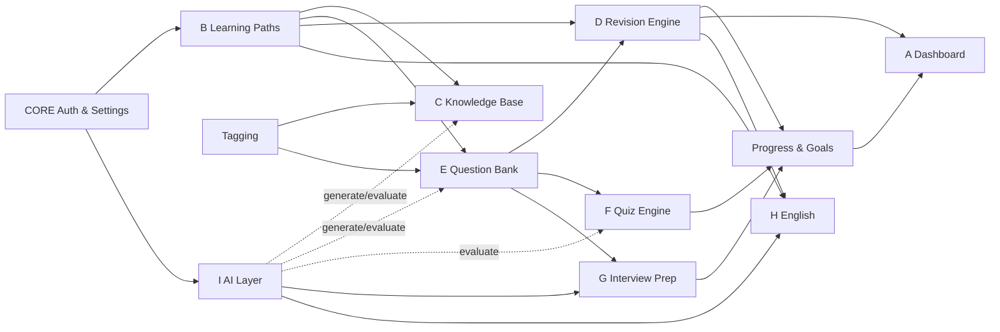

# LearnOS – Module Breakdown & Dependencies

## Modules

| Key | Module | Responsibility | Owns tables | Phase |
|---|---|---|---|---|
| CORE | Auth & Settings | Registration, Sanctum SPA session, profile, timezone, retention target, daily limits | users (+ Laravel defaults) | 0 |
| B | Learning Paths | Path → module → topic → subtopic tree, levels, ordering, resources, completion | learning_paths, modules, topics, resources | 1 |
| TAG | Tagging (shared) | User tags on notes, questions, flashcards, resources | tags, taggables | 1 |
| C | Knowledge Base | Markdown notes (kinds), snippets, mistakes, full-text search | notes | 2 |
| E | Question Bank | Question formats and categories, options, explanations, references, review status | questions, question_options | 3 |
| D | Revision Engine | Flashcards, FSRS scheduling, review sessions, logs, forgetting risk, weak topics | flashcards, revision_schedules, revision_logs | 4 |
| F | Quiz Engine | Quiz definitions, question selection, timed attempts, grading, history | quizzes, quiz_questions, quiz_attempts, user_answers | 5 |
| PROG | Progress (shared) | Topic mastery, daily activity rollups, streaks, goals | user_topic_progress, study_days, learning_goals | 1 (basic) → 6 |
| A | Dashboard & Analytics | Aggregated read models: due, streak, goals, weak topics, retention, trends | (reads only) | 6 |
| I | AI Layer | Provider-independent LLM client, prompts, conversations, generation jobs, evaluation | ai_conversations, ai_messages, ai_generations | 7 → 10 |
| G | Interview Prep | Profiles, mock sessions, follow-ups, coding evaluation, reports | interview_profiles, interview_sessions, interview_responses | 8 |
| H | English | Vocabulary, daily words, writing, speaking, reading, professional communication | vocabulary_words, user_vocabulary, practice_prompts, practice_submissions | 9 |

`practice_prompts` and `practice_submissions` also serve **Feynman** explanations (kind = `feynman`), so Module H's tables are generic "open-ended practice" tables that Module D and AI also use.

## Dependency graph

Solid arrows are hard dependencies (the module needs the other's tables or services). Dotted arrows show AI features added to a module that already works without AI.

### Rules that follow from the graph
1. **Every module works without AI.** AI is additive (generate, evaluate, explain). Manual paths are built first, so outages or missing keys never block core learning.
2. **Progress is written in one place.** Revision, quiz, interview and practice services call `ProgressRecorder` (study_days and mastery recompute) instead of updating rollups themselves.
3. **Content modules never read progress tables directly.** The dashboard and analytics read them through query services.
4. Interview Prep reuses the Question Bank and the AI evaluator. English reuses Learning Paths (grammar and reading as a seeded path), Revision (vocabulary as flashcards) and practice submissions.

## Cross-cutting services

| Service | Used by | Notes |
|---|---|---|
| `FsrsScheduler` (pure) | Revision, Quiz (optional "add to revision") | No DB or framework dependencies |
| `ReviewService` | Revision | Loads the schedule, calls the scheduler, writes the schedule and log in one transaction, calls `ProgressRecorder` |
| `ProgressRecorder` | Revision, Quiz, Interview, Practice | Upserts `study_days`; dispatches `RecalculateTopicMastery` job |
| `MasteryCalculator` (pure) | Progress job | Inputs: retrievabilities, accuracy, coverage → 0–100 |
| `QuizBuilder` | Quiz, Interview | Selection by scope, difficulty, type and interleaving |
| `AnswerGrader` | Quiz, Interview | Auto-grades objective questions; queues AI evaluation for open answers |
| `LlmClient` contract | AI tasks | Driver per provider and a fake for tests |
| `KnowledgeSearch` | Notes search, AI KB Q&A | MySQL FULLTEXT now; embeddings later behind the same method |
